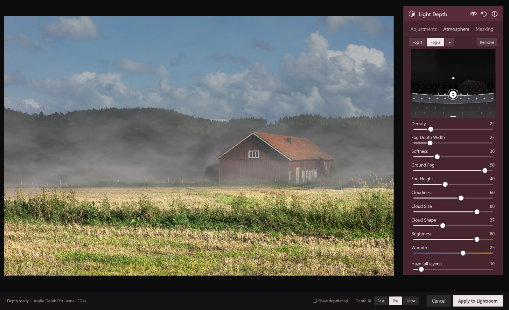
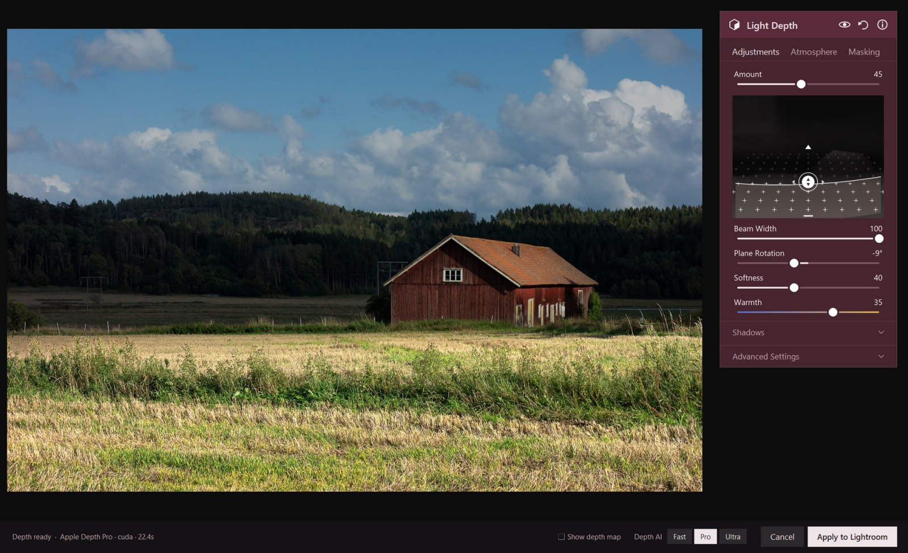
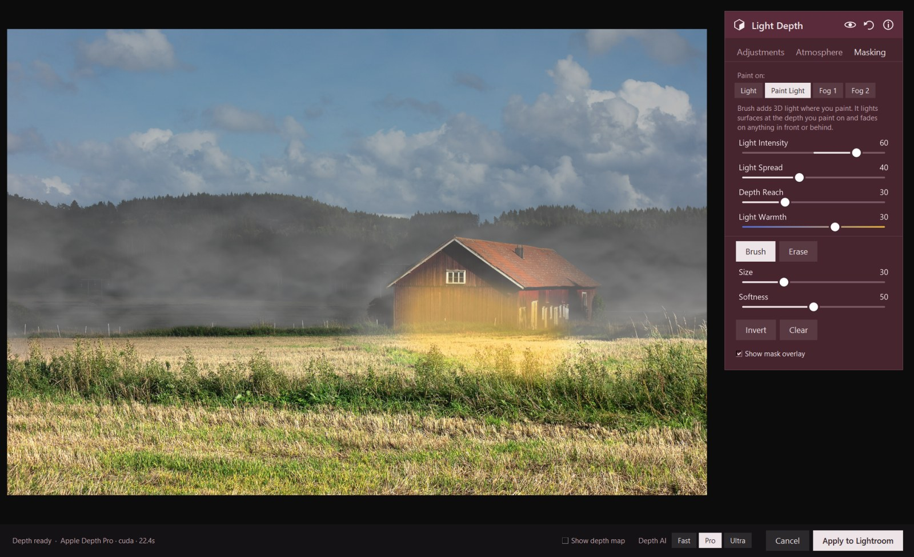
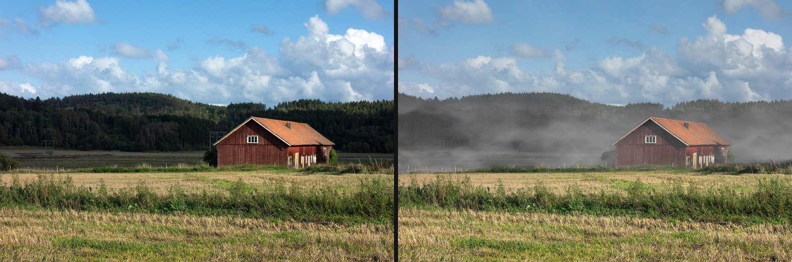
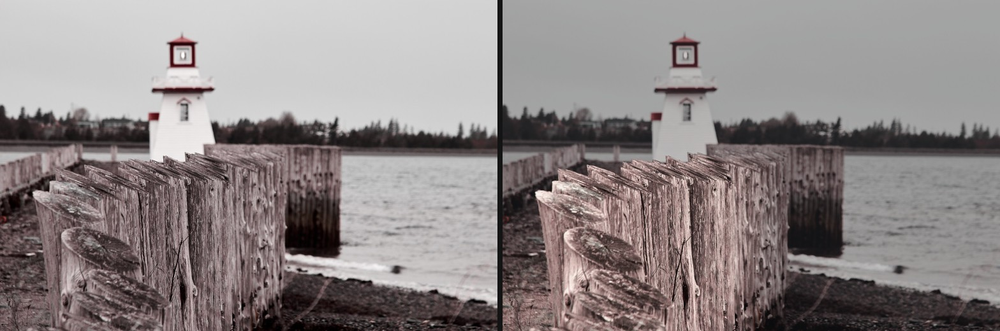
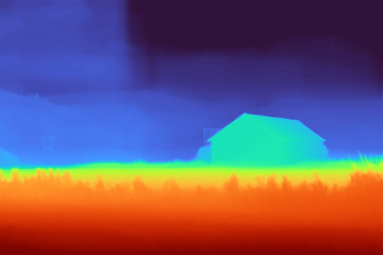

# Dimensional Light

**AI depth relighting for Adobe Lightroom Classic**, inspired by Luminar Neo's *Light Depth*.
Estimate a high-quality depth map of any photo, then light it in 3D: push light through the
scene, add volumetric fog that drifts *between* objects, paint light onto surfaces, and cast
real shadows, all with a live preview.



<details><summary>More screenshots</summary>




</details>

## Examples

| | |
|---|---|
| **Volumetric mist**: a thin fog layer sits between the barn and the forest. It passes behind the barn, and the barn stays crisp. |  |
| **Depth light**: warm light on the foreground pilings, with the water and treeline pushed back. |  |

*Left: original. Right: Dimensional Light. Rendered with [`tools/render_examples.py`](tools/render_examples.py).*

## Features

**Adjustments (the depth light)**
- **Amount, Softness, Warmth**: the Luminar-style essentials.
- **Interactive depth pad**: drag the handle up and down to move the light plane through the scene, and left and right to change the **Beam Width** (how deep the lit zone reaches).
- **Plane Rotation**: tilt the light plane so light sweeps in from one side.
- **Shadows** (toggle): screen-space cast shadows from the depth map. Pick where the light comes from on a shaded ball; anything behind a nearer object stays dark.
- **Advanced**: near/far brightness and warmth, plus a 3D side light shaded from depth-derived surface normals, aimed with the same angle ball.

**Atmosphere**
- **Volumetric fog layers**: add as many as you like. Each layer has its own depth pad (position and width), softness, density, ground fog and height, cloudiness, cloud size, cloud shape, brightness and warmth.
- The fog is rendered as a true volume (20 slices). It passes behind near objects and in front of far ones, and the light beam glows through it.
- **Haze**: cool aerial perspective on the far distance.

**Masking**
- Separate brushes for the **Light**, **Paint Light** and each **Fog layer**.
- **Paint Light** adds 3D light where you paint. It lives at the depth of the surfaces you paint on, so it doesn't spill onto things in front or behind.

**Depth AI** (switch in the bottom bar)
| Mode | Model | Speed (RTX 5060 laptop) |
|---|---|---|
| Fast | Depth Anything V2 Large | ~2 s |
| Pro (default) | Apple Depth Pro, log-metric distance | ~1-8 s |
| Ultra | Marigold diffusion (10-pass ensemble) fused with Depth Pro | ~30 s, runs in the background |

In Ultra mode, Depth Pro is shown first so you can start editing right away. The Ultra depth swaps in when it's ready, and your settings and brush strokes are kept. Depth maps are cached per photo.

<p align="center"></p>

## How it works

1. The Lightroom plugin exports the selected photo, with your Lightroom edits, as a 16-bit TIFF.
2. The companion app estimates depth, upsamples it edge-aware (guided filter) and opens the live editor.
   - Lightroom plugins can't draw into the Develop module, so the live UI is a separate window.
3. **Apply to Lightroom** renders at full resolution, writes a 16-bit TIFF next to the original (keeping the ICC profile) and imports it, stacked above the original.

## Install

**Full step-by-step guide: [docs/INSTALL.md](docs/INSTALL.md)**, including requirements, troubleshooting, updating and uninstalling.

Quick version (Windows 10/11, Lightroom Classic, Python 3.10-3.13, NVIDIA GPU recommended):

1. Download **`DimensionalLight-vX.Y.Z.zip`** from the [latest release](https://github.com/eetan-J/dimensional-light/releases/latest) and extract it to a permanent folder.
2. Double-click **`Install.bat`**. It sets up a private Python environment, installs PyTorch (CUDA if an NVIDIA GPU is found) and downloads the depth models (about 6 GB).
3. In Lightroom Classic: **File > Plug-in Manager > Add**, then select the `DimensionalLight.lrdevplugin` folder.

## Use

Select a photo, then **File** (or **Library**) **> Plug-in Extras > Dimensional Light...**

Try it without Lightroom:

```powershell
.\.venv\Scripts\python.exe app\app.py --demo
.\.venv\Scripts\python.exe app\app.py --input photo.jpg --output photo-relit.tif
```

Tips: double-click any slider to reset it, and use the mouse wheel for fine steps. On the depth pad, scroll moves the plane, Shift+scroll changes the beam width, and Ctrl+scroll rotates the plane. The eye icon compares with the original. If something goes wrong, the log is at `%TEMP%\dimlight.log`.

## Limitations

- The result is a new rendered TIFF, not a non-destructive Lightroom adjustment.
- Monocular depth can be wrong on glass, reflections, very thin structures and featureless skies. Fog and shadow edges follow the depth map, errors included.
- Shadows are screen-space: they're cast from what the camera can see, not from hidden geometry.

## Credits and licences

- **Code:** [MIT](LICENSE). This covers this repository's code only, not the depth models below.

- **Example photos** (all CC0, public domain, Wikimedia Commons):
  - [Barn in Färlev 1](https://commons.wikimedia.org/wiki/File:Barn_in_F%C3%A4rlev_1.jpg)
  - [Coast Lighthouse Architecture](https://commons.wikimedia.org/wiki/File:Coast_Lighthouse_Architecture.jpg)
- **Depth models** are downloaded from Hugging Face at install time and keep their own licences:
  - [Depth Anything V2](https://huggingface.co/depth-anything/Depth-Anything-V2-Large-hf): Large/Base weights are CC-BY-NC-4.0, non-commercial.
  - [Apple Depth Pro](https://huggingface.co/apple/DepthPro-hf): Apple sample-code licence.
  - [Marigold](https://huggingface.co/prs-eth/marigold-depth-v1-1): see the model card.

  Check these before any commercial use.
- Not affiliated with Skylum or Adobe. "Luminar" and "Lightroom" are trademarks of their owners.
